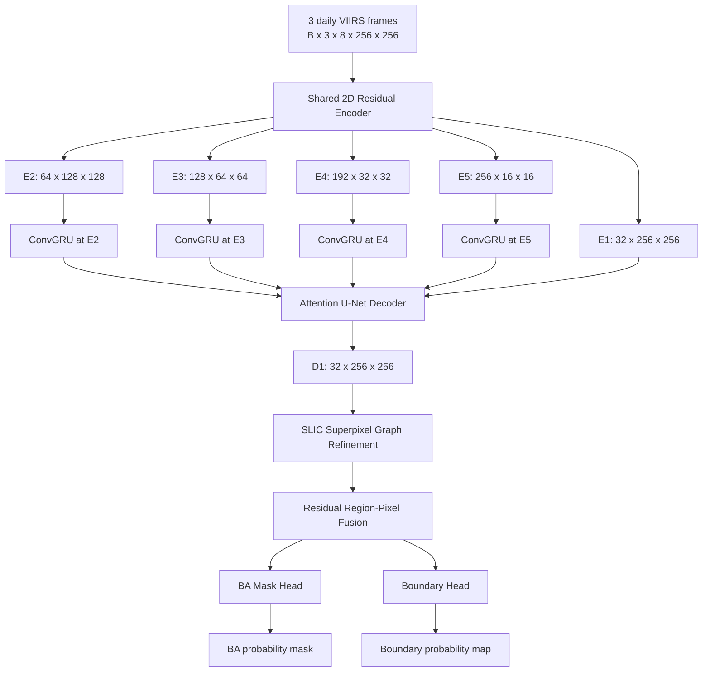

# Product Requirements Document (PRD)

# BARA-Net

**Burned-Area Region-Aware Network**  
**Project:** Temporal multispectral wildfire burned-area segmentation on TS-SatFire  
**Document status:** Implementation specification v1.0  
**Date:** 10 November 2026  
**Primary task:** Daily burned-area mapping (binary semantic segmentation)  
**Framework:** PyTorch  
**Model family:** Shared 2D residual encoder + multi-scale ConvGRU + attention decoder + superpixel graph refinement + dual prediction heads

---

## 0. Document purpose

Dokumen ini merupakan spesifikasi produk dan engineering untuk membangun BARA-Net. Dokumen ini sengaja menetapkan **satu rancangan utama** yang konsisten, bukan daftar alternatif arsitektur.

PRD ini menjadi acuan untuk:

- implementasi data pipeline TS-SatFire;
- implementasi model dan seluruh submodul;
- implementasi training, validation, inference, dan evaluation;
- penyusunan baseline dan ablation study;
- pengujian kebenaran data, tensor, loss, dan output;
- pencatatan eksperimen agar hasil dapat direproduksi.

Dokumen ini bukan klaim bahwa arsitektur sudah terbukti mengungguli model lain. Semua peningkatan performa harus dibuktikan melalui eksperimen dengan split, preprocessing, dan protokol evaluasi yang konsisten.

### 0.1. Istilah normatif

Kata berikut memiliki makna khusus:

- **MUST / WAJIB:** syarat yang harus dipenuhi sebelum implementasi dianggap benar.
- **SHOULD / SEBAIKNYA:** ketentuan yang sangat dianjurkan; penyimpangan harus dicatat.
- **MAY / OPSIONAL:** fitur tambahan yang tidak diperlukan untuk versi pertama.
- **Gate:** pemeriksaan yang harus lulus sebelum tahap berikutnya boleh dilakukan.

### 0.2. Keputusan final yang dikunci

| Elemen | Keputusan |
|---|---|
| Task | Daily burned-area mapping, bukan active-fire detection atau next-day progression |
| Target | Binary cumulative burned-area mask untuk tanggal terakhir pada input window |
| Temporal window | 3 observasi berurutan, interval 1 hari |
| Input logical channels | 8 kanal VIIRS per tanggal, setelah pemetaan band diverifikasi |
| Input tensor | `B × 3 × 8 × 256 × 256` |
| Spatial patch | `256 × 256`, stride `192` |
| Encoder | Shared-weight 2D residual CNN |
| Temporal fusion | ConvGRU pada E2, E3, E4, E5; hidden dimension 64 |
| Decoder | Attention-gated U-Net decoder |
| Graph input | Decoder feature pada resolusi 256 × 256 + spektral I2, I3, M11 |
| Superpixel | SLIC, target 1.024 region per patch |
| Graph | Spatial adjacency graph + 2-layer edge-aware GATv2 |
| Prediction | BA mask head + auxiliary boundary head |
| Loss | `0.50 Focal-Tversky + 0.35 Dice + 0.15 Boundary` |
| Optimizer | AdamW, learning rate `3e-4`, weight decay `1e-4` |
| Training budget | Maksimum 100 epoch, 3 seeds |
| Primary evaluation | Fire-level macro F1 dan pixel-level micro F1, keduanya dilaporkan |

---

# 1. Executive summary

BARA-Net adalah model segmentasi area terbakar yang menggabungkan informasi multispektral VIIRS dari beberapa hari dengan penalaran spasial berbasis superpixel graph.

Model menerima tiga observasi harian untuk satu fire event. Setiap observasi berisi delapan logical VIIRS input channels. Shared 2D encoder mengekstraksi representasi spasial dari setiap tanggal. ConvGRU menggabungkan representasi temporal pada empat skala resolusi. Attention-guided decoder membangun kembali representasi pada resolusi input. Setelah itu, Superpixel Graph Refinement (SGR) melakukan message passing antarwilayah homogen yang berdekatan. Hasil refinement diteruskan ke mask head untuk menghasilkan burned-area mask serta ke boundary head sebagai auxiliary supervision.

Kontribusi utama BARA-Net adalah **Temporal Superpixel Graph Refinement**: node superpixel dibentuk dari temporal decoder features, kemudian diperbarui menggunakan graph attention yang mempertimbangkan hubungan spasial dan perbedaan spektral. Representasi node yang telah diperbarui dikembalikan ke setiap piksel dan digabungkan secara residual dengan feature CNN.

BARA-Net hanya menyelesaikan task burned-area mapping. Model tidak memprediksi active fire, tidak memprediksi area yang akan terbakar besok, dan tidak menggunakan auxiliary FirePred channels pada versi pertama. Pembatasan ini menjaga fokus eksperimen dan membuat kontribusi SGR dapat diuji secara terisolasi.

---

# 2. Problem definition

## 2.1. Problem statement

Diberikan rangkaian tiga observasi VIIRS berurutan dari satu fire event:

\[
X_{t-2}, X_{t-1}, X_t
\]

Model memprediksi mask area yang sudah terbakar hingga tanggal target `t`:

\[
\hat{Y}_t = f_\theta(X_{t-2}, X_{t-1}, X_t)
\]

Dengan:

- `X_t`: observasi multispektral untuk tanggal `t`;
- `Y_t`: cumulative burned-area ground-truth mask untuk tanggal `t`;
- `\hat{Y}_t`: probabilitas burned area pada setiap piksel;
- `f_\theta`: BARA-Net dengan parameter `\theta`.

Task ini merupakan **segmentation / mapping**, bukan forecasting. Semua input harus berasal dari tanggal `t` atau sebelumnya. Tidak boleh ada informasi dari tanggal setelah `t` yang masuk ke preprocessing input.

## 2.2. Task boundary

| Term | Definisi | Status |
|---|---|---|
| Active-fire detection | Mendeteksi titik/piksel api aktif saat observasi | Di luar scope |
| Burned-area mapping | Memetakan area yang telah terbakar sampai tanggal observasi target | **Scope utama** |
| Fire-progression prediction | Memprediksi area baru yang akan terbakar setelah observasi terakhir | Di luar scope |

## 2.3. Target semantics

Target adalah cumulative burned-area mask, bukan mask active fire dan bukan burned-area increment.

Untuk piksel `p`:

\[
Y_t(p) = \begin{cases}
1 & \text{jika piksel merupakan bagian dari burned area pada tanggal } t \\
0 & \text{jika piksel merupakan non-burned area pada tanggal } t
\end{cases}
\]

Label BA pada rilis TS-SatFire disimpan sebagai kode finite/non-finite, bukan sebagai probabilitas. Berdasarkan audit independen 2026, finite values pada BA label merepresentasikan piksel terbakar; `NaN` merepresentasikan non-burned pixel **pada label yang memang tersedia**. Nilai finite tidak boleh diperlakukan sebagai intensitas, skor, atau regression target.

**Penting:** label yang seluruhnya `NaN` pada sebuah event yang tidak memiliki anotasi tidak boleh otomatis dianggap sebagai ground truth all-negative. Ketersediaan anotasi harus dipisahkan dari nilai mask.

---

# 3. Goals, non-goals, dan success criteria

## 3.1. Goals

1. Menghasilkan binary burned-area probability map untuk setiap target date yang valid.
2. Memanfaatkan temporal context dari tiga observasi harian.
3. Menguji manfaat region-level graph reasoning terhadap decoder CNN temporal.
4. Mempertahankan detail batas area terbakar melalui auxiliary boundary supervision.
5. Menjalankan evaluasi berdasarkan fire event agar performa tidak didominasi oleh event besar.
6. Menyediakan pipeline eksperimen yang dapat direproduksi dan diaudit.

## 3.2. Non-goals

Versi pertama BARA-Net tidak mencakup:

- active-fire classification;
- next-day fire progression forecasting;
- multi-task learning untuk AF, BA, dan FP sekaligus;
- penggunaan seluruh 19 auxiliary `FirePred` channels;
- penggunaan Sentinel, Landsat, MODIS, atau sumber eksternal tambahan;
- image foundation model atau pretrained vision transformer;
- post-processing berbasis polygon manual;
- klaim real-time wildfire alerting;
- estimasi luas kebakaran dalam hektare tanpa transformasi geospasial dan validasi area.

## 3.3. Success criteria

Proyek dianggap selesai secara engineering apabila:

- seluruh gate audit dataset lulus;
- data loader menghasilkan tensor dan mask dengan shape serta semantik yang benar;
- forward pass full BARA-Net menghasilkan dua output berukuran `B × 1 × 256 × 256`;
- seluruh komponen loss finite dan dapat di-backpropagate;
- model dapat dilatih dan checkpoint dapat di-resume;
- inference full-scene mencakup seluruh piksel tanpa coverage gap;
- baseline dan seluruh ablation dapat dijalankan pada protokol yang sama;
- hasil dapat direproduksi menggunakan seed dan config yang tersimpan;
- seluruh metrik disertai jumlah fire event dan jumlah valid pixels yang digunakan.

Tidak ada target F1/IoU numerik yang dijadikan syarat lulus sebelum baseline diukur. Target angka baru boleh ditetapkan setelah baseline dan variasi seed diketahui.

---

# 4. Dataset requirements and data contract

## 4.1. Dataset source

Dataset: **TS-SatFire**.

Rilis dataset mengorganisasikan data berdasarkan fire event. Dataset paper menjelaskan tiga task: active-fire detection, daily burned-area mapping, dan wildfire progression prediction. Setiap fire event memiliki rangkaian VIIRS observations serta data auxiliary. Rilis publik disediakan dalam GeoTIFF dan repository resminya menyediakan data preparation code.

Referensi utama:

- Dataset paper: https://www.nature.com/articles/s41597-025-06271-3
- Official repository: https://github.com/zhaoyutim/TS-SatFire
- Kaggle dataset: https://www.kaggle.com/datasets/z789456sx/ts-satfire
- Independent 2026 audit: https://doi.org/10.3390/s26165116

## 4.2. Expected logical folder structure

Nama file dan subfolder aktual harus diambil dari dataset yang diunduh. Secara logis, adapter harus mendukung struktur per-fire seperti berikut:

```text
ts_satfire/
├── <FIRE_ID_1>/
│   ├── VIIRS_Day/
│   │   ├── <DATE_1>.tif
│   │   ├── <DATE_2>.tif
│   │   └── ...
│   ├── VIIRS_Night/
│   │   ├── <DATE_1>.tif
│   │   └── ...
│   └── FirePred/
│       ├── ...
│       └── ...
├── <FIRE_ID_2>/
└── ...
```

Ini merupakan logical contract, bukan jaminan bahwa semua nama file persis sama. `DatasetIndexer` harus membaca folder aktual dan membuat manifest yang eksplisit.

## 4.3. Input channels

Logical model input berisi delapan VIIRS channels per tanggal:

| Logical channel | Variable | Penggunaan |
|---:|---|---|
| 0 | Day I1 (Red) | Input |
| 1 | Day I2 (NIR) | Input + SLIC |
| 2 | Day I3 (SWIR) | Input + SLIC |
| 3 | Day I4 (MIR) | Input; cumulative max preprocessing |
| 4 | Day I5 (thermal IR) | Input; cumulative max preprocessing |
| 5 | Day M11 (SWIR) | Input + SLIC |
| 6 | Night I4 | Input; cumulative max preprocessing |
| 7 | Night I5 | Input; cumulative max preprocessing |

### 4.3.1. Mandatory band-mapping audit

**Implementer MUST NOT assume that logical channel numbers equal the GeoTIFF band indices.**

TS-SatFire raster conventions require careful separation antara input channels dan label channels. Dataset documentation describes eight logical VIIRS input channels, while the 2026 audit identifies AF and BA labels in dedicated positions of the released `VIIRS_Day` GeoTIFF. Karena itu, implementasi wajib melakukan inspeksi aktual terhadap raster sebelum memilih band.

`data_audit.py` MUST produce, for every raster type:

- raster path and fire ID;
- number of bands;
- width, height, CRS, transform, dtype, and nodata value;
- per-band finite percentage;
- per-band min, max, mean, standard deviation, and selected quantiles;
- per-band count of NaN, positive infinity, and negative infinity;
- band descriptions/tags if present;
- candidate label channels and candidate input channels;
- validation that the selected BA band has the expected finite/non-finite encoding;
- confirmation that no label channel is selected as model input.

Band mapping must be stored in a single configuration file, for example `configs/data/ts_satfire_ba.yaml`. It must not be scattered as magic indices across loader code.

A hard assertion must stop the pipeline if:

- the BA target band is also selected as an input channel;
- the expected input channel count does not match 8;
- paired day/night rasters do not refer to the same fire/date;
- the spatial dimensions or geotransform are inconsistent and cannot be reconciled;
- no valid BA-label availability manifest exists.

## 4.4. Label channels

The BA label is stored in the VIIRS Day data product according to TS-SatFire conventions. The 2026 audit reports that the BA channel contains finite numeric codes for burned pixels and `NaN` for non-burned pixels.

Once the BA channel index has been verified by the audit:

```python
ba_mask = np.isfinite(ba_band).astype(np.uint8)
```

The numeric value itself is discarded. Do not normalize the BA label, do not threshold it as a regression value, and do not apply `nan_to_num` before constructing the binary mask.

The AF label is not used by BARA-Net.

## 4.5. Label availability versus negative class

This distinction is mandatory.

The dataset has incomplete annotation coverage for some fire events. A label-availability manifest must distinguish:

- `VALID`: BA label exists and may contain burned and non-burned pixels;
- `UNAVAILABLE`: BA annotation for the event/day cannot be used as supervision;
- `UNKNOWN`: audit has not resolved the annotation status.

Only `VALID` samples may contribute to training or metric computation.

Rules:

1. A valid BA label may contain `NaN` at non-burned pixels; these pixels become class 0.
2. An entirely `NaN` BA raster must not automatically be interpreted as a valid all-negative label.
3. An event with no usable BA annotations must be excluded from BA supervision and reported in the audit output.
4. A partially labelled event may be retained only for dates explicitly marked `VALID`.
5. Unknown annotation state is a hard data validation error, not an implicit negative label.

The manifest must be saved to `data/manifests/ba_label_availability.csv` and include at minimum:

```text
fire_id,date,split,label_status,valid_pixel_count,burned_pixel_count,source_path,review_note
```

The audit summary should be compared against published audit counts when the same dataset release and split are used. Counts must not be hard-coded as an assumption because local Kaggle revisions, missing downloads, and path differences can change the effective pool.

## 4.6. Splits

Split unit is **fire event**, never patch, date, or pixel.

Use the released TS-SatFire BA split definitions and preserve their fire IDs. Do not randomly split patches from the same fire into train and validation. Do not use the separate named AF test events as a substitute for BA test events.

Required manifest:

```text
fire_id,split,task,source_split,usable_ba_days,notes
```

The data audit must report:

- number of discovered fires;
- number of fires assigned to each official split;
- number missing on disk;
- number with no BA annotation;
- number with partial BA annotation;
- number retained for BA training, validation, and test;
- number of valid target windows in each split.

A 2026 independent audit reports approximately 106 usable BA training fires, 8 validation fires, and 22 US_2021 BA test fires under its audited pool. These figures are a **reconciliation reference**, not a substitute for verifying the downloaded copy.

## 4.7. Temporal window construction

Locked configuration:

```yaml
temporal:
  sequence_length: 3
  sampling_interval_days: 1
  target_position: last
  stride: 1
  require_consecutive_dates: true
```

For target date `t`, a sample consists of:

```text
Input:  [t-2, t-1, t]
Target: BA(t)
```

The three observations must be consecutive valid acquisition dates according to the release's temporal indexing. If a required date is absent, the window is rejected; do not silently substitute a non-consecutive date.

The label for the target date must have `label_status=VALID`.

## 4.8. Thermal cumulative maximum preprocessing

For BA mapping, the TS-SatFire methodology aggregates daytime and nighttime I4/I5 thermal channels using pixel-wise maximum over the current and preceding observations.

For each date `d`, define the cumulative thermal value:

\[
I^{cum}_{b,d}(p)=\max_{\tau\le d,\;\tau\in\mathcal{D}_{fire}} I_{b,\tau}(p)
\]

where `b` is one of Day I4, Day I5, Night I4, or Night I5, and `\mathcal{D}_{fire}` contains available observations from the beginning of the event through `d`.

Requirements:

- cumulative maximum must be computed chronologically;
- no observation after date `d` may influence the cumulative value at `d`;
- missing values must be ignored when a valid earlier/current value exists;
- if every value is missing for a pixel/channel history, preserve a missing marker until normalization;
- cache the cumulative values by fire/date to avoid recomputing the entire history for every overlapping temporal window.

For the three-frame sample, each frame contains the thermal cumulative state as of its own date. It is not correct to apply the final date's thermal maximum to all three frames.

## 4.9. Normalization and missing inputs

Normalization is fitted on the training split only.

For each input channel independently:

1. collect finite training pixels from valid training fires;
2. compute lower and upper clipping quantiles at 1% and 99%;
3. clip finite values to those bounds;
4. map the clipped values using training-set mean and standard deviation;
5. replace remaining non-finite input values with 0 after standardization.

Save fitted parameters to `artifacts/preprocessing/channel_stats.json` and load the same values for validation, test, and inference.

Do not fit normalization statistics on validation or test data. Do not normalize labels. Do not include label values in statistics.

If the dataset's released values are already scaled/calibrated, the audit must still verify numeric ranges and preserve the chosen transformation in the saved configuration. The exact preprocessing is part of the experiment and must be consistent across all model variants.

## 4.10. Auxiliary data policy

The 19 `FirePred` auxiliary channels are intentionally excluded from BARA-Net v1.0.

Reason:

- the central research question concerns temporal VIIRS representation and graph refinement;
- auxiliary variables introduce another modality and confound attribution of improvement;
- keeping the input contract at eight logical channels simplifies fair baselines.

They may be considered only in a later, separately versioned PRD.

---

# 5. Spatial sampling and patch generation

## 5.1. Patch configuration

```yaml
spatial:
  patch_size: 256
  stride: 192
  overlap: 64
  cover_entire_scene: true
```

Generate a regular overlapping grid for each valid scene. The final row and column positions must be adjusted so the last patch reaches the scene boundary. If required, pad only the image tensor; padded locations must be marked invalid and excluded from all losses and metrics.

The data pipeline must retain:

- original fire ID;
- date;
- full-scene dimensions;
- patch row/column index;
- pixel coordinates of the patch in the full scene;
- valid label mask;
- superpixel map identifier.

## 5.2. Why overlapping full-scene patches

A single fixed center crop can omit burned pixels outside the crop. BARA-Net therefore uses full-scene tiling to avoid systematically ignoring peripheral burned regions.

This is a custom evaluation protocol. Scores obtained through full-scene tiled inference must not be presented as directly comparable to published figures that use a different crop or scoring convention. All BARA-Net baselines and ablations must use the same full-scene protocol.

## 5.3. Training patch sampling

Only patches whose target day has a valid BA annotation are eligible.

Training sampler:

- 50% of sampled patches must contain at least one positive BA pixel;
- 50% are sampled uniformly from all valid patches;
- sampling is performed within the training split only;
- a patch may be sampled more than once in an epoch only through the sampler's seeded replacement policy;
- validation and test always use the natural, unbalanced distribution.

This sampling policy improves exposure to positive regions without modifying validation/test prevalence. The sampling ratio must be fixed for all model comparisons.

## 5.4. Geometric augmentation

Augmentation must be applied identically to all three input frames, BA mask, validity mask, and SLIC map:

- horizontal flip;
- vertical flip;
- rotation by 90°, 180°, or 270°.

No independent temporal augmentation is allowed. No random crop after graph construction is allowed. No elastic deformation, arbitrary rotation, spectral mixup, or label interpolation is included in v1.0.

Input images use bilinear interpolation only if resizing is absolutely necessary; masks, validity maps, and superpixel IDs use nearest-neighbor interpolation. The standard pipeline does not resize patches.

---

# 6. Model architecture specification

## 6.1. High-level architecture



All dimensions below exclude the batch dimension unless otherwise stated.

## 6.2. Input tensor contract

```text
inputs: float32/float16 [B, T=3, C=8, H=256, W=256]
sp_map: int64          [B, H=256, W=256]
ba_target: float32    [B, 1, H=256, W=256]
valid_mask: bool      [B, 1, H=256, W=256]
```

The model input contains only the eight logical VIIRS image channels. Labels, fire IDs, dates, geospatial transforms, and annotation-validity metadata must never be concatenated into the model input.

## 6.3. Module A — Shared Multispectral 2D Residual Encoder

### Purpose

Extract spatial and spectral representations for every frame while sharing weights across dates.

### Frame processing

For every timestamp `t_i`:

\[
(E^1_{t_i}, E^2_{t_i}, E^3_{t_i}, E^4_{t_i}, E^5_{t_i})
= Encoder(X_{t_i})
\]

The same encoder instance is reused for all three frames.

### Stage specification

| Stage | Resolution | Output channels | Operation |
|---|---:|---:|---|
| Stem / E1 | 256 × 256 | 32 | Conv 3×3, GN, GELU, residual block |
| E2 | 128 × 128 | 64 | Downsample Conv 3×3 stride 2 + residual block |
| E3 | 64 × 64 | 128 | Downsample Conv 3×3 stride 2 + residual block |
| E4 | 32 × 32 | 192 | Downsample Conv 3×3 stride 2 + residual block |
| E5 | 16 × 16 | 256 | Downsample Conv 3×3 stride 2 + residual block |

### Residual block

Each residual block contains:

1. 3×3 convolution;
2. GroupNorm with 8 groups;
3. GELU;
4. 3×3 convolution;
5. GroupNorm with 8 groups;
6. identity or 1×1 projected residual path;
7. addition followed by GELU.

Use `padding=1`. Bias may be disabled when followed by GroupNorm.

### Requirements

- one shared encoder object is called for all three timestamps;
- encoder must support flattening `B×T` for efficient batched frame encoding;
- output channels must match the table exactly;
- no temporal interaction occurs inside this encoder;
- no pretrained weights are required.

## 6.4. Module B — Multi-scale ConvGRU Temporal Fusion

### Purpose

Aggregate temporal evidence while retaining two-dimensional spatial structure.

### Placement

ConvGRU is applied at E2, E3, E4, and E5. E1 is deliberately excluded to control memory and preserve a high-resolution skip from the latest frame.

### Projection

Each level is projected to 64 channels using a 1×1 convolution before entering its ConvGRU:

```text
E2:  64 -> 64
E3: 128 -> 64
E4: 192 -> 64
E5: 256 -> 64
```

### ConvGRU equations

For projected input `x_t` and hidden state `h_(t-1)`:

\[
z_t=\sigma(W_z * [x_t,h_{t-1}])
\]

\[
r_t=\sigma(W_r * [x_t,h_{t-1}])
\]

\[
\widetilde h_t=\tanh(W_h * [x_t,r_t\odot h_{t-1}])
\]

\[
h_t=(1-z_t)\odot h_{t-1}+z_t\odot\widetilde h_t
\]

All `W` operations are 3×3 convolutions with padding 1. Hidden dimension is 64 at every temporal scale. Hidden state is initialized to zeros for every sample and every scale.

Process frames chronologically: `t-2`, then `t-1`, then `t`.

### Temporal feature fusion

The final hidden state is concatenated with the corresponding feature from the latest frame, then projected back to that encoder stage's native channel width:

\[
F_l=Conv_{1\times1}([E_l^t \Vert h_l^t])
\]

Output channels:

- F2: 64;
- F3: 128;
- F4: 192;
- F5: 256.

E1 skip remains `E1_t`, the feature of the latest frame only.

### Requirements

- temporal order must never be shuffled;
- hidden state must be reset between independent samples/fire windows;
- the sequence must use no future date;
- temporal fusion output shape must match its corresponding encoder stage;
- a unit test must verify that changing an earlier frame can change final hidden features.

## 6.5. Module C — Attention-Guided U-Net Decoder

### Purpose

Recover full spatial resolution and selectively pass useful encoder information through skip connections.

### Decoder stages

| Decoder stage | Decoder source | Skip source | Output channels | Output size |
|---|---|---|---:|---:|
| D4 | F5 | F4 | 192 | 32 × 32 |
| D3 | D4 | F3 | 128 | 64 × 64 |
| D2 | D3 | F2 | 64 | 128 × 128 |
| D1 | D2 | E1_t | 32 | 256 × 256 |

### Upsampling

Use bilinear interpolation with `align_corners=False`, followed by a 3×3 convolution to the stage output width.

### Attention gate

For skip feature `x` and upsampled decoder gating feature `g`:

\[
\alpha=\sigma(\psi^T ReLU(W_x x + W_g g))
\]

\[
x_{att}=\alpha\odot x
\]

`W_x`, `W_g`, and `\psi` are 1×1 convolutions. Intermediate attention width is `max(16, output_channels // 2)`. Upsampled decoder and attended skip are concatenated and passed through one residual block to produce the decoder output.

### Requirements

- skip attention is spatially varying;
- all decoder outputs have the resolutions in the table;
- D1 output is exactly `[B, 32, 256, 256]`;
- attention gates do not receive labels or SLIC masks.

## 6.6. Module D — Superpixel Graph Refinement (SGR)

SGR is the central contribution of BARA-Net.

### 6.6.1. Design rationale

CNN features describe local pixel patterns. Superpixel graph reasoning provides a region-level representation and allows adjacent, spectrally similar regions to exchange information. SGR operates on temporally enriched decoder features so that the graph nodes encode both spatial/spectral characteristics and temporal evidence.

SGR is not a post-processing operation on the final binary mask. It refines internal features before prediction.

### 6.6.2. SLIC input

Use the latest-date channels:

```text
[I2_t, I3_t, M11_t]
```

These three channels are normalized with training-set channel statistics. They are passed as a three-channel array to SLIC. `convert2lab=False` because these are multispectral satellite channels, not RGB values.

Locked parameters:

```yaml
slic:
  n_segments: 1024
  compactness: 10.0
  sigma: 1.0
  start_label: 0
  enforce_connectivity: true
  convert2lab: false
  channel_axis: -1
```

The number of returned superpixels may differ slightly from the requested target due to connectivity enforcement and image structure. The graph must use the actual number of unique labels returned by SLIC.

SLIC is non-differentiable and is computed outside the neural network. No labels or model predictions may be used to generate SLIC segments.

### 6.6.3. Superpixel map

For each patch:

\[
S\in\mathbb{N}^{256\times256}
\]

`S[p]` is the node ID assigned to pixel `p`, and IDs must be contiguous from 0 to `K-1` after relabeling.

The SLIC map can be cached by patch because it depends only on the normalized latest-date input channels and fixed SLIC parameters.

### 6.6.4. Graph construction

Build an undirected spatial adjacency graph:

\[
G=(V,E)
\]

Each superpixel forms one node. Two nodes are connected if their superpixels share at least one boundary under 4-neighbor pixel adjacency. Store every undirected relationship in both directions for message passing. Add self-loops as required by the graph convolution implementation.

Graph complexity should remain sparse:

\[
|V|=K\approx1024, \qquad |E|=O(K)
\]

Do not construct a fully connected graph.

### 6.6.5. Node features

For node `i`, compute:

- mean-pooled D1 feature: 32 values;
- mean-pooled latest-date I2, I3, M11: 3 values.

Concatenate to 35 values:

\[
u_i=[MeanPool(D1|S_i)\Vert MeanPool(I2,I3,M11|S_i)]
\]

Project through an MLP:

```text
Linear(35, 64) -> GELU -> Dropout(0.1)
```

This yields `Z ∈ R^(K×64)`.

Mean pooling must be differentiable with respect to D1. Use scatter-add plus node counts, or an equivalent differentiable segment-reduction operation.

### 6.6.6. Edge attributes

Every directed edge `(i,j)` has two normalized attributes:

1. **Spectral distance:** Euclidean distance between mean `[I2,I3,M11]` vectors of nodes `i` and `j`, normalized by `sqrt(3)` and clipped to a documented range.
2. **Shared-boundary ratio:** number of shared boundary pixel pairs divided by `sqrt(area_i × area_j)`, clipped to `[0,1]`.

Thus:

\[
e_{ij}=[d_{spectral}(i,j), b_{shared}(i,j)]
\]

Edge attribute tensor shape is `[num_directed_edges, 2]`.

### 6.6.7. Edge-aware GATv2

Two GATv2 layers are used:

| Layer | Input dimension | Heads | Per-head dimension | Output dimension |
|---|---:|---:|---:|---:|
| GATv2-1 | 64 | 4 | 16 | 64 (concatenated) |
| GATv2-2 | 64 | 1 | 64 | 64 |

Both layers receive edge attributes with dimension 2. Use dropout 0.1, residual projection, LayerNorm, and GELU.

The implementation must pass edge attributes to the attention layer; simply computing edge attributes and then ignoring them does not satisfy this specification.

### 6.6.8. Node-to-pixel broadcast

Gather the updated node feature for every pixel using the SLIC ID map:

\[
R(p)=Z'_{S(p)}
\]

This produces a `[B,64,256,256]` region feature map. Project it to 32 channels using a 1×1 convolution.

### 6.6.9. Residual region-pixel fusion

Concatenate D1 and projected region map and fuse:

\[
F_{SGR}=D1+Conv_{1\times1}([D1\Vert R_{32}])
\]

Output shape:

```text
[B, 32, 256, 256]
```

The residual connection preserves pixel-level CNN information and allows graph refinement to contribute a learned correction.

### 6.6.10. Graph implementation requirements

- use a sparse graph representation;
- graph operations must be differentiable for learned node features;
- SLIC and edge topology may be precomputed/cached;
- all patches in a batch must be handled without mixing nodes across different images;
- graph batching must preserve per-patch node offsets;
- graph output must be mapped back to the correct patch pixels;
- graph construction must never read BA labels;
- graph construction must not use validation/test labels;
- if a patch has a degenerate SLIC output, the pipeline must raise a clear error or apply the documented connectivity repair—not silently switch to a different model path.

## 6.7. Module E — Dual prediction heads

### 6.7.1. BA mask head

```text
Conv3x3(32 -> 32)
GroupNorm(8)
GELU
Conv1x1(32 -> 1)
```

Output is a raw logit map:

```text
ba_logits: [B, 1, 256, 256]
```

Apply sigmoid only for metric calculation and inference probability export.

### 6.7.2. Boundary head

```text
Conv3x3(32 -> 16)
GroupNorm(8)
GELU
Conv1x1(16 -> 1)
```

Output:

```text
boundary_logits: [B, 1, 256, 256]
```

Boundary head is auxiliary supervision only. The final BA probability map is produced only by the BA mask head. Boundary prediction must not be combined with the BA mask as an unvalidated post-processing rule.

---

# 7. Loss function and supervision

## 7.1. Total objective

\[
L_{total}=0.50L_{FT}+0.35L_{Dice}+0.15L_{Boundary}
\]

All components are computed only on pixels where `valid_mask=True`.

## 7.2. Focal Tversky loss

\[
TI=\frac{TP+\epsilon}{TP+\alpha FP+\beta FN+\epsilon}
\]

\[
L_{FT}=(1-TI)^\gamma
\]

Locked parameters:

```yaml
focal_tversky:
  alpha: 0.30
  beta: 0.70
  gamma: 0.75
  epsilon: 1.0e-7
```

`alpha` weights false positives and `beta` weights false negatives. Higher beta prioritizes reducing missed burned pixels.

Compute the loss per sample and then average across the batch so a large scene/patch does not automatically dominate the batch loss.

## 7.3. Dice loss

\[
L_{Dice}=1-\frac{2TP+\epsilon}{2TP+FP+FN+\epsilon}
\]

Compute per sample using valid pixels only, then average across the batch.

## 7.4. Boundary target

Boundary ground truth is derived from the binary BA mask using a 3×3 morphological gradient:

\[
Y_B=\operatorname{Dilate}_{3\times3}(Y)-\operatorname{Erode}_{3\times3}(Y)
\]

Boundary targets should be generated from the full-scene valid BA mask before patch slicing to avoid introducing artificial boundaries at patch edges. The resulting boundary map is then sliced using the same patch coordinates as the BA mask.

Padded or invalid pixels must not contribute to boundary supervision.

## 7.5. Boundary loss

\[
L_{Boundary}=0.5L_{BCE}+0.5L_{DiceBoundary}
\]

Use `BCEWithLogitsLoss` for stable numerical behavior. Boundary BCE positive weight is calculated from the training split only, saved in the experiment config, and capped to prevent extreme gradients.

Boundary Dice uses the same valid-pixel masking policy as the BA Dice loss.

## 7.6. Loss implementation requirements

- model heads return logits, not sigmoid outputs;
- `valid_mask` is applied before TP/FP/FN and BCE reductions;
- all loss components must remain finite;
- all-negative valid patches must still produce a finite loss;
- all-invalid patches must be rejected by the sampler rather than returning a misleading zero loss;
- boundary labels must not be generated from predicted masks;
- loss weights must remain fixed for all baseline and ablation runs.

---

# 8. Training specification

## 8.1. Locked training configuration

```yaml
training:
  epochs: 100
  batch_size: 4
  gradient_accumulation_steps: 2
  optimizer: adamw
  learning_rate: 0.0003
  weight_decay: 0.0001
  warmup_epochs: 5
  scheduler: cosine
  gradient_clip_norm: 1.0
  mixed_precision: true
  early_stopping_patience: 15
  num_workers: 4
  pin_memory: true
  persistent_workers: true
  seeds: [17, 42, 2026]
```

Batch size 4 with gradient accumulation 2 gives an effective optimizer batch size of 8, assuming all microbatches are full. If hardware constraints force a different microbatch, preserve effective batch size where possible and record the change. Do not silently reduce input resolution or remove graph layers to make training fit.

## 8.2. Optimizer

AdamW with:

- learning rate `3e-4`;
- weight decay `1e-4`;
- default beta values unless instability requires a documented change;
- no weight decay on bias and normalization parameters.

## 8.3. Learning-rate schedule

- linear warmup over first 5 epochs;
- cosine decay from warmup completion to final epoch;
- scheduler advances once per epoch;
- learning-rate history is logged.

## 8.4. Gradient handling

- automatic mixed precision enabled on supported CUDA hardware;
- gradient accumulation = 2;
- unscale gradients before clipping;
- clip global gradient norm to 1.0;
- optimizer step and zero-grad occur after each accumulation cycle;
- partial final accumulation cycle must be handled correctly.

## 8.5. Checkpointing

Save:

- best checkpoint by validation fire-level macro F1;
- latest checkpoint for resumption;
- model state;
- optimizer state;
- scheduler state;
- epoch and global step;
- random seeds and random generator states;
- exact configuration;
- channel normalization stats;
- selected validation threshold;
- code version/commit identifier where available.

## 8.6. Early stopping

Maximum epoch count is 100. Stop if validation macro F1 has not improved for 15 consecutive epochs after warmup. Always retain the best checkpoint, not merely the final epoch.

## 8.7. Repeated runs

Run seeds:

```text
17, 42, 2026
```

Every baseline, ablation, and full model must use the same seed set. Report mean and standard deviation across runs.

## 8.8. Training logs

Log at minimum:

- total training loss;
- Focal Tversky loss;
- Dice loss;
- Boundary loss;
- validation macro F1;
- validation micro F1;
- validation IoU;
- validation precision and recall;
- current learning rate;
- epoch time;
- GPU memory peak if available;
- number of training patches processed;
- positive-pixel fraction in sampled batches.

---

# 9. Inference and full-scene reconstruction

## 9.1. Sliding-window inference

Run inference on the full fire scene using the same `256 × 256` patch size and `192` stride.

All patches for the target day must use the same temporal window and preprocessing state. The model returns a probability map for each patch.

## 9.2. Overlap blending

Use weighted probability blending to reduce patch-edge discontinuities:

\[
P_{scene}(p)=\frac{\sum_k w_k(p)P_k(p)}{\sum_k w_k(p)}
\]

where `P_k` is a patch prediction and `w_k` is a deterministic 2D center-weighted blending window with a small positive floor. The floor ensures every covered pixel receives non-zero weight.

The same blending rule must be used for all model variants.

## 9.3. Coverage assertion

For every full scene:

- every original scene pixel must be covered by at least one patch;
- the accumulated denominator must be positive everywhere;
- no padded pixel may be included in final scene dimensions;
- output width/height must equal the original scene dimensions.

If any assertion fails, inference must stop and report the affected fire/date.

## 9.4. Threshold selection

The network exports probabilities. One global threshold is selected using validation data only.

Threshold selection procedure:

1. evaluate thresholds from 0.05 to 0.95 in increments of 0.01;
2. calculate fire-level macro F1 for each threshold;
3. choose the threshold with maximum validation macro F1;
4. for exact ties, choose the higher threshold;
5. store the selected threshold in the checkpoint metadata;
6. freeze it before test evaluation.

The test set must never be used to tune threshold, SLIC settings, normalization, or any training hyperparameter.

## 9.5. Output artifacts

For every predicted fire/date, save:

- probability map (`float32` GeoTIFF or NumPy array with geospatial sidecar);
- binary BA mask using the locked threshold;
- optional boundary probability map;
- visualization overlay;
- fire ID, date, threshold, checkpoint ID, and preprocessing config.

Output rasters must preserve original CRS and affine transform when exported as GeoTIFF.

---

# 10. Evaluation protocol

## 10.1. Primary metrics

| Metric | Aggregation | Purpose |
|---|---|---|
| Fire-level macro F1 | F1 computed per fire, then arithmetic mean across eligible fires | Primary generalization metric |
| Pixel-level micro F1 | Aggregate TP/FP/FN across all eligible evaluated pixels | Overall pixel performance |
| IoU | Report fire-level mean and/or global value with aggregation explicitly named | Region overlap |
| Precision | Fire-level mean and global micro value | False-positive behavior |
| Recall | Fire-level mean and global micro value | Missed burned-area behavior |
| Boundary F1 | Computed from boundary prediction with fixed tolerance | Perimeter quality |

Never report a metric without stating whether it is fire-macro or pixel-micro.

## 10.2. Empty-ground-truth handling

A valid labelled scene/window with zero positive BA pixels must be reported separately. It must not silently receive F1=1 and inflate the result. Report:

- number of evaluated fires with at least one positive target;
- number of valid evaluated windows with zero positive target;
- number of excluded/unlabelled windows;
- metric convention for zero-positive scenes.

Primary fire-level macro F1 is computed over fires with at least one valid positive target. False positives on valid all-negative windows still contribute to pixel-level micro counts and should also be reported through a dedicated false-positive rate/area statistic.

## 10.3. Label availability filtering

Only windows marked `VALID` in the BA availability manifest are scored. An unannotated window is not an all-negative ground truth.

## 10.4. Boundary F1

Boundary F1 must specify tolerance in pixels. Default tolerance is 1 pixel for 256-pixel patches/full-scene predictions. Report the tolerance in the results table. If scene resolution and pixel size vary, also consider documenting the approximate physical scale; do not imply sub-pixel boundary accuracy.

## 10.5. Reporting table

At minimum:

| Model | Seed | Eligible fires | Valid windows | Macro F1 | Micro F1 | Macro IoU | Precision | Recall | Boundary F1 |
|---|---:|---:|---:|---:|---:|---:|---:|---:|---:|
| U-Net per-frame | | | | | | | | | |
| U-Net + ConvGRU | | | | | | | | | |
| BARA-Net w/o SGR | | | | | | | | | |
| BARA-Net w/o boundary head | | | | | | | | | |
| Full BARA-Net | | | | | | | | | |

For each model, report mean ± standard deviation across the three seeds.

## 10.6. Comparability statement

The full-scene tiled evaluation protocol is BARA-Net's primary protocol. Published TS-SatFire scores may use different crops, window strides, filtering, thresholds, and metric aggregation. Therefore:

- do not compare raw scores as if they came from an identical protocol;
- state the BARA-Net protocol in every report;
- run baseline models through exactly the same pipeline;
- if reproducing an official benchmark protocol, report it in a separate table and identify all deviations.

---

# 11. Baselines and ablation plan

All experiments use identical data splits, patch extraction, augmentation, loss masking, optimizer budget, threshold-selection procedure, inference blending, and metrics unless the tested ablation explicitly removes a component.

## 11.1. Required baselines

### B1 — Per-frame U-Net

- input: latest frame only, `B × 8 × 256 × 256`;
- encoder-decoder: same residual encoder widths and decoder family where practical;
- no temporal module;
- no SGR;
- no boundary head for the minimal baseline;
- output: BA mask.

This establishes the spatial-only reference.

### B2 — U-Net + ConvGRU

- input: three frames;
- shared encoder;
- multi-scale ConvGRU at E2-E5;
- attention-guided decoder;
- no SGR;
- no graph feature input;
- output: BA mask.

This isolates the effect of temporal modelling before graph refinement.

## 11.2. Required ablations

### A1 — BARA-Net without SGR

Remove SLIC, graph construction, GATv2, node broadcasting, and graph fusion. Connect D1 directly to prediction heads. All other modules and training settings remain identical.

This is the most important ablation for the central graph contribution.

### A2 — BARA-Net without boundary head

Remove the auxiliary boundary head and set the boundary loss weight to zero. Renormalize remaining loss weights to preserve total weight 1.0 (`Focal-Tversky 0.5882`, `Dice 0.4118`). This isolates the benefit of boundary supervision.

## 11.3. Full model

Full BARA-Net contains every specified component.

## 11.4. Interpretation rules

- Full BARA-Net > BARA-Net without SGR supports the usefulness of SGR under this protocol.
- BARA-Net without SGR > U-Net + ConvGRU may indicate that decoder attention or other decoder details contribute; architecture parity must be checked before attributing the difference.
- Full BARA-Net > BARA-Net without boundary head supports the value of auxiliary boundary supervision.
- If differences are smaller than run-to-run standard deviation, do not claim a reliable improvement.
- A metric gain alone does not prove graph mechanism validity; include region-level visual inspection and failure cases.

---

# 12. Research contribution and claims policy

## 12.1. Intended contributions

**C1 — Multi-scale temporal burned-area representation.**  
A shared multispectral encoder and multi-scale ConvGRU combine short daily VIIRS observations while retaining spatial structure.

**C2 — Temporal Superpixel Graph Refinement.**  
Superpixel nodes pool temporal decoder features and spectral descriptors. Edge-aware graph attention exchanges information between spatially adjacent regions, and the refined region features are broadcast back to pixels through a residual fusion path.

**C3 — Region-aware, boundary-supervised segmentation.**  
Graph-derived regional context complements pixel-level CNN features, while auxiliary boundary supervision encourages better perimeter representation.

## 12.2. Claims that are not allowed without evidence

Do not claim:

- SLIC, ConvGRU, GATv2, or Attention U-Net are individually novel;
- BARA-Net is state-of-the-art before a fair comparison is completed;
- a higher crop-level score necessarily indicates better full-scene mapping;
- the dataset labels are perfect ground truth;
- SGR improves physical wildfire-boundary accuracy solely because it improves F1;
- temporal modelling improves results unless B1 and B2 support that conclusion;
- graph refinement improves results unless the no-SGR ablation supports that conclusion.

## 12.3. Label-quality limitations

TS-SatFire BA labels are derived from accumulated VIIRS active-fire observations and NIFC perimeter information with quality-control decisions. They can contain omission and commission errors. Treat them as dataset annotations, not infallible physical boundaries.

The result section must include representative true-positive, false-positive, false-negative, and boundary-error visualizations.

---

# 13. Software architecture and repository structure

Recommended repository layout:

```text
baranet/
├── README.md
├── PRD.md
├── pyproject.toml
├── requirements.txt
├── configs/
│   ├── data/
│   │   └── ts_satfire_ba.yaml
│   ├── model/
│   │   └── baranet.yaml
│   ├── train/
│   │   └── default.yaml
│   └── experiments/
│       ├── unet_frame.yaml
│       ├── unet_convgru.yaml
│       ├── baranet_no_sgr.yaml
│       ├── baranet_no_boundary.yaml
│       └── baranet_full.yaml
├── scripts/
│   ├── audit_dataset.py
│   ├── build_manifest.py
│   ├── prepare_dataset.py
│   ├── train.py
│   ├── evaluate.py
│   ├── predict_scene.py
│   └── visualize_predictions.py
├── src/
│   └── baranet/
│       ├── __init__.py
│       ├── data/
│       │   ├── indexer.py
│       │   ├── geotiff_reader.py
│       │   ├── band_mapping.py
│       │   ├── label_audit.py
│       │   ├── temporal_windows.py
│       │   ├── normalization.py
│       │   ├── patching.py
│       │   ├── superpixel_cache.py
│       │   └── dataset.py
│       ├── models/
│       │   ├── residual_blocks.py
│       │   ├── encoder.py
│       │   ├── convgru.py
│       │   ├── attention_gate.py
│       │   ├── decoder.py
│       │   ├── graph_builder.py
│       │   ├── graph_refinement.py
│       │   ├── prediction_heads.py
│       │   ├── baranet.py
│       │   └── baselines.py
│       ├── losses/
│       │   ├── focal_tversky.py
│       │   ├── dice.py
│       │   ├── boundary.py
│       │   └── combined.py
│       ├── engine/
│       │   ├── trainer.py
│       │   ├── evaluator.py
│       │   ├── inference.py
│       │   ├── checkpoint.py
│       │   └── reproducibility.py
│       ├── metrics/
│       │   ├── segmentation.py
│       │   ├── boundary.py
│       │   └── aggregation.py
│       └── utils/
│           ├── config.py
│           ├── logging.py
│           └── visualization.py
├── data/
│   ├── raw/                  # local dataset; not committed
│   ├── manifests/
│   ├── processed/
│   └── cache/
├── artifacts/
│   ├── preprocessing/
│   ├── checkpoints/
│   ├── predictions/
│   ├── metrics/
│   └── figures/
├── notebooks/
│   └── exploratory_audit.ipynb
└── tests/
    ├── test_band_mapping.py
    ├── test_label_semantics.py
    ├── test_temporal_windows.py
    ├── test_cumulative_thermal.py
    ├── test_patching.py
    ├── test_slic_graph.py
    ├── test_model_shapes.py
    ├── test_losses.py
    ├── test_inference_coverage.py
    └── test_no_leakage.py
```

Large GeoTIFFs, caches, model checkpoints, and prediction rasters must not be committed to the source repository. Add them to `.gitignore`.

---

# 14. Configuration contract

The model and data pipeline must be controlled by config files. Do not scatter architecture constants through code.

Example `configs/model/baranet.yaml`:

```yaml
model:
  name: baranet
  input_channels: 8
  sequence_length: 3
  patch_size: 256

encoder:
  type: shared_residual_2d
  channels: [32, 64, 128, 192, 256]
  norm: group_norm
  norm_groups: 8
  activation: gelu

temporal:
  type: convgru
  levels: [E2, E3, E4, E5]
  hidden_channels: 64
  kernel_size: 3

decoder:
  type: attention_unet
  channels: [192, 128, 64, 32]
  upsample: bilinear
  align_corners: false
  attention_intermediate_min: 16

sgr:
  enabled: true
  slic:
    n_segments: 1024
    compactness: 10.0
    sigma: 1.0
    start_label: 0
    enforce_connectivity: true
    convert2lab: false
  node_feature_dim: 64
  node_input_dim: 35
  edge_feature_dim: 2
  gatv2:
    layers: 2
    first_heads: 4
    first_head_dim: 16
    second_heads: 1
    second_head_dim: 64
    dropout: 0.1

heads:
  ba_mask:
    enabled: true
    output_channels: 1
  boundary:
    enabled: true
    hidden_channels: 16
    output_channels: 1
```

The implementation must parse the canonical config with a YAML parser during tests; malformed indentation, unknown keys, or duplicate keys must fail validation.

Example `configs/data/ts_satfire_ba.yaml`:

```yaml
dataset:
  name: TS-SatFire
  root: data/raw/ts_satfire
  task: burned_area_mapping
  split_manifest: data/manifests/ts_satfire_ba_splits.csv
  label_availability_manifest: data/manifests/ba_label_availability.csv

bands:
  mapping_file: data/manifests/verified_band_mapping.json
  expected_input_channels: 8
  logical_order: [I1_DAY, I2_DAY, I3_DAY, I4_DAY, I5_DAY, M11_DAY, I4_NIGHT, I5_NIGHT]
  ba_label_name: BA_LABEL

temporal:
  sequence_length: 3
  interval_days: 1
  target_position: last
  cumulative_max_channels: [I4_DAY, I5_DAY, I4_NIGHT, I5_NIGHT]

normalization:
  fit_split: train
  lower_quantile: 0.01
  upper_quantile: 0.99
  replace_nonfinite_after_scaling: 0.0

patches:
  size: 256
  stride: 192
  pad_mode: reflect
  full_scene_coverage: true
```

Implementation note: remove the leading indentation before `temporal:` in the example YAML when serializing the actual config file. Configuration loading must fail on unknown keys to catch typos.

---

# 15. CLI and expected workflows

The following commands define the intended interface. Exact flag names may be refined during implementation, but the workflow and outputs must remain.

## 15.1. Dataset audit

```bash
python scripts/audit_dataset.py \
  --data-root data/raw/ts_satfire \
  --task ba \
  --output-dir data/manifests/audit
```

Outputs:

- `raster_inventory.csv`;
- `band_statistics.csv`;
- `verified_band_mapping.json` (only after explicit mapping validation);
- `fire_split_inventory.csv`;
- `ba_label_availability.csv`;
- `audit_summary.json`;
- sample visualization of candidate BA mask channels.

## 15.2. Dataset preparation

```bash
python scripts/prepare_dataset.py \
  --config configs/data/ts_satfire_ba.yaml
```

Outputs:

- normalized input cache;
- cumulative thermal cache;
- target masks and validity metadata;
- full-scene patch index;
- SLIC maps and sparse graph metadata;
- preparation summary and rejected-window report.

## 15.3. Training

```bash
python scripts/train.py \
  --data-config configs/data/ts_satfire_ba.yaml \
  --model-config configs/model/baranet.yaml \
  --train-config configs/train/default.yaml \
  --experiment-name baranet_full_seed17 \
  --seed 17
```

## 15.4. Evaluation

```bash
python scripts/evaluate.py \
  --checkpoint artifacts/checkpoints/baranet_full_seed17/best.pt \
  --split val \
  --full-scene
```

Test evaluation must only be started after threshold selection and experiment configuration have been frozen.

## 15.5. Full-scene inference

```bash
python scripts/predict_scene.py \
  --checkpoint artifacts/checkpoints/baranet_full_seed17/best.pt \
  --fire-id <FIRE_ID> \
  --date <YYYY-MM-DD> \
  --output-dir artifacts/predictions/baranet_full_seed17
```

---

# 16. Testing and acceptance criteria

## 16.1. Dataset audit tests

| ID | Test | Acceptance criteria |
|---|---|---|
| DATA-01 | Raster inventory | Every discovered GeoTIFF is indexed with fire ID/date/path |
| DATA-02 | Band mapping | Logical input bands and label bands are disjoint and explicitly verified |
| DATA-03 | Label semantics | Finite BA code becomes 1; NaN on a valid label becomes 0 |
| DATA-04 | Missing annotation | Unavailable label is excluded, never silently made all-negative |
| DATA-05 | Split isolation | No fire ID appears in more than one split |
| DATA-06 | Temporal order | Every sample contains three chronologically ordered consecutive dates |
| DATA-07 | Thermal accumulation | Cumulative max at date d never uses data from date > d |
| DATA-08 | Normalization | Statistics are fitted only on training fires |
| DATA-09 | Input contract | Input tensor has exactly 8 logical channels |

## 16.2. Patch and graph tests

| ID | Test | Acceptance criteria |
|---|---|---|
| GRAPH-01 | SLIC output | IDs are contiguous and every pixel belongs to one node |
| GRAPH-02 | No label leakage | SLIC and graph builder accept image/feature inputs only |
| GRAPH-03 | Adjacency | Edges correspond to 4-neighbor shared boundaries |
| GRAPH-04 | Edge attributes | Every directed edge has exactly 2 finite values |
| GRAPH-05 | Node pooling | Node features have shape `[K, 35]` before projection |
| GRAPH-06 | Graph attention | Edge attributes reach both GATv2 layers |
| GRAPH-07 | Batch isolation | No graph edge connects nodes from two different patches |
| GRAPH-08 | Broadcast | Every pixel receives the feature of its assigned superpixel |
| GRAPH-09 | Differentiability | Gradient flows from SGR output back to D1 feature |

## 16.3. Model tests

| ID | Test | Acceptance criteria |
|---|---|---|
| MODEL-01 | Encoder | Output shapes match E1-E5 specification |
| MODEL-02 | Weight sharing | All frames use the same encoder parameter objects |
| MODEL-03 | ConvGRU | Output channels and spatial sizes match each stage |
| MODEL-04 | Temporal order | Hidden states are evaluated in chronological order |
| MODEL-05 | Decoder | D1 shape equals `[B,32,256,256]` |
| MODEL-06 | SGR | Refined feature shape equals `[B,32,256,256]` |
| MODEL-07 | Heads | Both outputs equal `[B,1,256,256]` |
| MODEL-08 | Finite output | No NaN/Inf logits on a valid synthetic batch |
| MODEL-09 | Backprop | All trainable modules participating in forward pass receive gradients |

## 16.4. Loss tests

| ID | Test | Acceptance criteria |
|---|---|---|
| LOSS-01 | Focal Tversky | Finite scalar and non-zero gradient on valid sample |
| LOSS-02 | Dice | Finite scalar and correct behavior for perfect prediction |
| LOSS-03 | Boundary | Finite scalar and non-zero gradient |
| LOSS-04 | Valid mask | Invalid pixels do not affect loss value |
| LOSS-05 | All-negative target | Loss remains finite |
| LOSS-06 | All-invalid target | Sample is rejected before loss calculation |

## 16.5. Inference tests

| ID | Test | Acceptance criteria |
|---|---|---|
| INF-01 | Coverage | Every full-scene pixel is covered |
| INF-02 | Blending | Accumulation denominator is positive everywhere |
| INF-03 | Dimensions | Output shape equals original scene dimensions |
| INF-04 | Geospatial metadata | Exported GeoTIFF preserves CRS and affine transform |
| INF-05 | Threshold | Test inference uses stored validation threshold |

## 16.6. Definition of Done

BARA-Net v1.0 is considered implementation-complete only when all of the following are true:

- [ ] Dataset audit and band mapping are reviewed and frozen.
- [ ] BA availability manifest is complete.
- [ ] Fire-level split leakage test passes.
- [ ] Three-day window construction passes all tests.
- [ ] Cumulative thermal preprocessing is causal and tested.
- [ ] Baseline B1 trains and evaluates.
- [ ] Baseline B2 trains and evaluates.
- [ ] BARA-Net without SGR trains and evaluates.
- [ ] Full BARA-Net forward/backward pass works.
- [ ] Full BARA-Net completes training for the three locked seeds or documents a compute interruption.
- [ ] Validation threshold is selected and frozen.
- [ ] Full-scene inference has no coverage gaps.
- [ ] Metrics include macro and micro aggregation labels.
- [ ] Mean and standard deviation across seeds are reported.
- [ ] Qualitative error analysis includes FP, FN, and perimeter examples.
- [ ] Configurations, logs, checkpoints, and predictions are saved.

---

# 17. Milestones and implementation order

Implementation must follow this order. Do not start graph optimization before the dataset and temporal baseline are validated.

## M0 — Repository and environment

Deliverables:

- repository structure;
- dependency/environment file;
- config loader;
- logging and seed utilities;
- basic CI/unit-test setup.

Exit criteria: imports work and a synthetic test can run on CPU.

## M1 — Dataset forensic audit

Deliverables:

- GeoTIFF inventory;
- actual band mapping;
- BA label semantics checks;
- event/day label availability manifest;
- official split manifest;
- visual inspection artifacts.

Exit criteria: all data contract gates pass. No model training before M1 is complete.

## M2 — Preprocessing and baseline data loader

Deliverables:

- chronological event indexing;
- cumulative thermal preprocessing;
- training-only normalization;
- three-frame window generator;
- full-scene patch grid;
- validity-aware data loader.

Exit criteria: visual inspection of multi-date input and target aligns correctly; no future-date leakage.

## M3 — Baseline models

Deliverables:

- per-frame U-Net;
- U-Net + multi-scale ConvGRU;
- training/evaluation loop;
- macro/micro metrics;
- initial baseline report.

Exit criteria: both baselines complete a short sanity run and a full planned training run.

## M4 — BARA-Net encoder, temporal module, decoder

Deliverables:

- shared residual encoder;
- ConvGRU fusion;
- attention-guided decoder;
- mask and boundary heads;
- loss suite.

Exit criteria: shape, gradient, and loss tests pass. The model without SGR can train.

## M5 — SGR

Deliverables:

- SLIC preprocessing/cache;
- adjacency graph construction;
- edge attributes;
- temporal node pooling;
- edge-aware GATv2;
- node-to-pixel broadcast;
- residual graph fusion.

Exit criteria: graph unit tests pass and gradients propagate through node features to the decoder.

## M6 — Full training and ablation

Deliverables:

- three-seed experiments;
- best checkpoints;
- training curves;
- validation thresholds;
- ablation comparison.

Exit criteria: all planned runs and evaluation are recorded, or compute limitations are explicitly documented.

## M7 — Full-scene evaluation and reporting

Deliverables:

- full-scene probability maps;
- binary masks;
- metric tables;
- qualitative overlays;
- failure-case analysis;
- reproducibility manifest.

Exit criteria: final results can be regenerated from config and checkpoint.

---

# 18. Risks and mitigations

| Risk | Impact | Mitigation |
|---|---|---|
| Incorrect GeoTIFF band indexing | Label leakage or wrong inputs | Mandatory band audit; explicit mapping file; hard assertions |
| Missing BA annotations treated as negatives | Biased training and misleading metrics | Separate label availability manifest from binary mask |
| Fire event leakage across splits | Inflated validation/test metrics | Split only by fire ID; automated overlap test |
| Future thermal observation leakage | Invalid temporal evaluation | Causal cumulative-max implementation with unit test |
| Tiny effective BA dataset after filtering | Overfitting and unstable scores | Fire-level reporting, repeated seeds, regularization, transparent counts |
| Positive-pixel imbalance | Poor burned-area recall | Focal Tversky, Dice, positive-aware patch sampler |
| SLIC segments cross physical boundaries | Graph smoothing across different regions | Spectral edge attributes, residual pixel path, boundary supervision, visual audit |
| SGR adds too much memory/latency | Training infeasibility | Sparse graph, cached topology, 1,024 target segments, profiling |
| Full-scene protocol differs from published crop | Scores not directly comparable | Report protocol explicitly; same protocol for every baseline |
| Label perimeter noise | Boundary metric instability | Report boundary metric and qualitative errors; avoid claiming perfect physical boundary |
| Small validation fire count | Threshold/selection variance | Report per-fire metrics and run-to-run variance; avoid overclaiming |
| SLIC preprocessing drift | Inconsistent graph structure across runs | Fixed parameters, cached maps, versioned preprocessing metadata |

---

# 19. Reproducibility requirements

Every experiment directory must contain:

```text
artifacts/experiments/<experiment_name>/
├── config.yaml
├── environment.txt
├── git_commit.txt
├── seed.txt
├── preprocessing/
│   ├── channel_stats.json
│   ├── band_mapping.json
│   └── split_manifest.csv
├── logs/
│   ├── train.csv
│   └── validation.csv
├── checkpoints/
│   ├── best.pt
│   └── latest.pt
├── metrics/
│   ├── validation.json
│   ├── test.json
│   └── per_fire.csv
├── predictions/
└── figures/
```

Reproducibility controls:

- seed Python, NumPy, PyTorch CPU, and CUDA;
- store seed and library versions;
- use deterministic operations where practical;
- if a graph/scatter operation is nondeterministic on the selected GPU, record that limitation;
- preserve the exact split and label availability manifests;
- preserve the preprocessing configuration and training statistics;
- do not overwrite prior experiment directories.

---

# 20. Final locked architecture summary

```text
INPUT
  3 consecutive daily observations
  8 logical VIIRS channels per date
  Shape: B × 3 × 8 × 256 × 256

SHARED MULTISPECTRAL ENCODER
  E1: 32  × 256 × 256
  E2: 64  × 128 × 128
  E3: 128 × 64  × 64
  E4: 192 × 32  × 32
  E5: 256 × 16  × 16

TEMPORAL FUSION
  ConvGRU at E2, E3, E4, E5
  Hidden dimension: 64 at each level
  Latest-frame feature concatenated with final hidden state

DECODER
  Attention-guided U-Net decoder
  D1 output: 32 × 256 × 256

SUPERPIXEL GRAPH REFINEMENT
  SLIC from latest-date [I2, I3, M11]
  Target segments: 1,024 per patch
  Node input: pooled D1 (32) + pooled spectral (3)
  Node embedding: 64
  Graph: 4-neighbor adjacency
  Edge features: spectral distance + shared-boundary ratio
  Graph layers: 2 edge-aware GATv2 layers
  Node feature broadcast to pixels
  Residual pixel-region fusion

PREDICTION
  BA mask head: B × 1 × 256 × 256 logits
  Boundary head: B × 1 × 256 × 256 logits

LOSS
  0.50 Focal Tversky
  0.35 Dice
  0.15 Boundary

TRAINING
  AdamW, LR 3e-4, weight decay 1e-4
  Batch 4, gradient accumulation 2
  100 epochs maximum, 5 epoch warmup + cosine
  3 seeds: 17, 42, 2026

INFERENCE
  Full-scene overlapping patches
  Patch 256, stride 192
  Weighted probability blending
  Threshold selected on validation and frozen before test
```

---

# 21. References

1. Zhao, Y., Gerard, S., & Ban, Y. (2025). *TS-SatFire: A Multi-Task Satellite Image Time-Series Dataset for Wildfire Detection and Prediction*. Scientific Data. https://doi.org/10.1038/s41597-025-06271-3
2. Official TS-SatFire repository. https://github.com/zhaoyutim/TS-SatFire
3. TS-SatFire Kaggle release. https://www.kaggle.com/datasets/z789456sx/ts-satfire
4. Mavros, N., & Katsaros, D. (2026). *SpaSE-UNet3D: Sensor-Driven Wildfire Detection and Progression Prediction from VIIRS Multispectral Imagery*. Sensors, 26(16), 5116. https://doi.org/10.3390/s26165116

The 2026 audit is used here primarily for data-quality and label-encoding guardrails. Its reported model experiments concern active-fire detection and fire-progression prediction; it does not establish BARA-Net performance for burned-area mapping.

---

# 22. Change log

| Version | Date | Changes |
|---|---|---|
| 1.0 | 2026-11-10 | Initial implementation PRD; locks task, architecture, data safeguards, training, evaluation, ablations, and acceptance criteria. |
